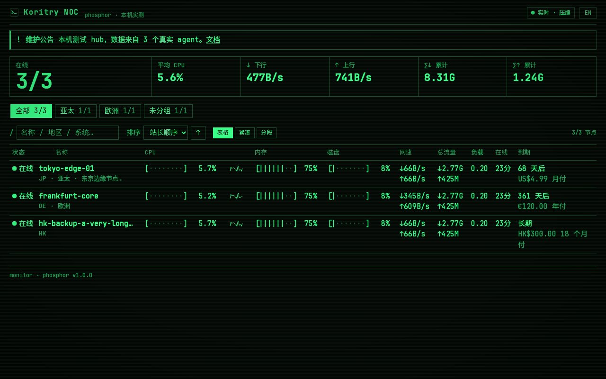

# Phosphor 磷光终端

机房 NOC 磷光终端风格：纯黑底、单色磷光字、表格行与字符条，详情页仿 top/htop。只有深色。



## 安装

在 Monitor hub 后台「主题」中选择「从 GitHub 安装」，粘贴：

```text
https://github.com/LYISTR2/monitor-theme-phosphor
```

也可下载 [v1.0.1 的 theme.tar.gz](https://github.com/LYISTR2/monitor-theme-phosphor/releases/download/v1.0.1/theme.tar.gz) 后上传安装。

## v1.0.1

右上角新增磷光终端命令风格的「进入后台」按钮，直接打开 `/admin`；随荧绿、琥珀、冰蓝配色变化，并支持中英文、键盘导航和手机端。

## 文件与许可

作者：Koritry。主题代码采用 [MIT](LICENSE) 许可。
主题自带字体及其许可证保留在 `dist/fonts/`。

本仓库保存提供的预编译主题：`theme.json`、`preview.png` 和 `dist/`；未包含原始开发源码或构建工具链。
发布包名固定为 `theme.tar.gz`，主题版本 `1.0.1` 对应 Release 标签 `v1.0.1`。
